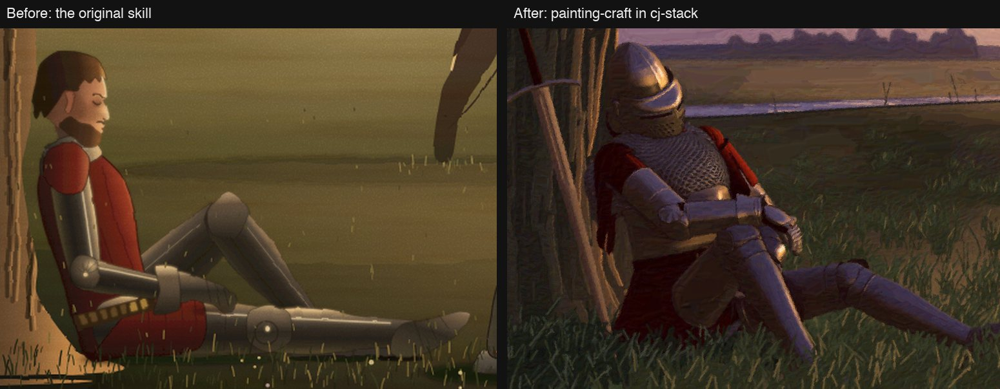

# painting-craft

A skill that makes Claude draw and paint pictures in code (SVG, canvas, numpy, Blender) to a gallery standard. Claude studies references first, then reviews its own screenshots at 2x zoom.



The left side is the original skill. The right side is this version. More pairs are in the [root README](../../../../README.md#painting-craft-before-and-after).

## When to use it

Claude loads this skill when you ask for a scene, figure, creature, vehicle, building or landscape drawn in code. It also loads when a picture looks flat, floats or has wrong proportions.

- It fixes four failures: wrong proportion, wrong art tradition, broken space and structure, and guessed costume or place.
- It also loads when you paste reference art or ask for costume, armour or vehicle research.

Do not use it for UI icons, charts or diagrams.

## Example

You say: "Paint a 1600x1000 SVG of a knight asleep against an oak tree at dusk, in a Romantic oil-painting look."

1. Claude asks which artists you like and how closely you will zoom in, unless a project note already says.
2. Claude fetches public-domain reference images and builds the knight and the tree as separate studies.
3. Claude composes the picture, runs a paint pass, then shoots and reviews it on desktop and phone.

You get the picture at twice its display size, plus the before and after shots and the commands that made them.

## Install

The `visual` plugin ships this skill. Add the marketplace, then install the plugin:

```
/plugin marketplace add cpeaustriajc/dotfiles
/plugin install visual@dotfiles
```

To turn the plugin off, run `claude plugin disable visual@dotfiles`. This also turns off every other skill in `visual`.

## What it does

The skill is a nine-step workflow: tradition, research, space and light, masses, hero studies, composition, grounding, one medium pass, zoomed review. Its scripts live in `scripts/`.

- Claude asks about your taste first. It offers to save the answers as a note in your project.
- Claude fetches references with `refs.py` (the Met and Wikimedia Commons) and compares its crop beside them with `compare.py`.
- A figure that turns or sits is built in 3D with `render3d.py`. The seated knight in `knight.py` is the worked example.
- `paintpass.py` gives a painted picture one brushwork style. `shoot.mjs` and `crop.py` make the zoomed review shots.
- Claude marks guessed facts UNVERIFIED and names proxy values in the commit message.

Scripts need Python packages (numpy, scipy, pillow) and Playwright. `render3d.md` and `SKILL.md` give the exact commands.

## Limits

- It does not draw UI icons, charts or diagrams.
- It cannot rescue a weak drawing with the paint pass. The pass only unifies what is there.
- Flat-vector and graphic styles skip the paint pass.
- It has no settings.

## More

- [SKILL.md](SKILL.md): the workflow and the review checklist.
- [references/recipes.md](references/recipes.md): how to build foliage, metal, cloth, faces, windows and water.
- [references/anatomy.md](references/anatomy.md), [scale.md](references/scale.md), [armour.md](references/armour.md), [render3d.md](references/render3d.md) and [code-techniques.md](references/code-techniques.md): measurements and techniques.
- [evals/triggers.json](evals/triggers.json): example requests that should and should not load the skill.
